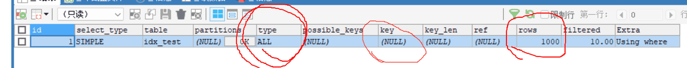
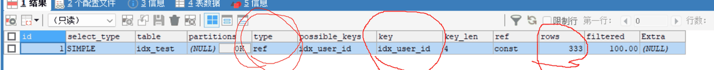

# EXPLAIN 对比：加索引前后

## 环境

- 数据库：`study_db`
- 表：`idx_test`，**1000 行**
- 查询：`SELECT * FROM idx_test WHERE user_id = 2`
- 工具：SQLyog，`EXPLAIN` 看执行计划

## 加索引前

| 列 | 值 |
|---|---|
| select_type | SIMPLE |
| table | idx_test |
| type | **ALL** |
| possible_keys | NULL |
| key | **NULL** |
| key_len | NULL |
| ref | NULL |
| rows | **1000** |
| filtered | 10.00 |
| Extra | Using where |

**解释**

- `type = ALL`：全表扫描，MySQL 要从第 1 行读到第 1000 行 
- `key = NULL`：没有用任何索引 
- `filtered = 10.00`：扫完 1000 行后，预计只有 10% 的行满足条件 
- `Extra = Using where`：拿到行之后还要再按 `WHERE` 过滤 

也就是说：**先读 1000 行，再丢掉约 900 行**

## 加索引后

| 列 | 值 |
|---|---|
| select_type | SIMPLE |
| table | idx_test |
| type | **ref** |
| possible_keys | idx_user_id |
| key | **idx_user_id** |
| key_len | 4 |
| ref | const |
| rows | **333** |
| filtered | 100.00 |
| Extra | NULL |

**解释**

- `type = ref`：通过索引定位，不再是全表扫
- `key = idx_user_id`：实际用了 `user_id` 上的索引
- `key_len = 4`：索引只用了 4 字节，对应一个 `INT`
- `ref = const`：条件里是常量 `2`，直接用常量去索引里查
- `rows = 333`：预计只扫描约 333 行
- `filtered = 100.00`：索引定位出来的行全部满足条件，不需要再过滤
- `Extra = NULL`：没有额外的过滤动作

## 前后对比

| 指标 | 加索引前 | 加索引后 | 变化 |
|---|---|---|---|
| type | ALL | ref | 全表扫 → 索引定位 |
| key | NULL | idx_user_id | 用上索引 |
| rows | 1000 | 333 | 少扫约 2/3 |
| filtered | 10.00 | 100.00 | 不需要二次过滤 |

`rows` 从 1000 降到 333，符合预期：`user_id` 只有 3 个值（1、2、3），
每个值大约占 1/3 的行，所以用索引查一个值只需要扫 1/3 

## 结论

1. **索引把「逐行判断」变成「先定位再读」**，扫描行数从 1000 降到 333 
2. **索引不是越多越好**：每个索引都要占磁盘，还会拖慢 `INSERT / UPDATE / DELETE`，
   因为写入时要同步维护索引 
3. **小表看不出效果**：`orders` 只有 10 行时，优化器判断全表扫更快，会直接忽略索引，
   `EXPLAIN` 里 `key` 依然是 `NULL` 所以本次对比用的是 1000 行的 `idx_test` 
4. **判断有没有走索引，只看两列**：`type` 是不是 `ALL`、`key` 是不是 `NULL` 

## 附：三种常见的索引失效写法

| 写法 | 为什么失效 | 改写 |
|---|---|---|
| `WHERE status LIKE '%paid%'` | 左边有 `%`，无法从索引开头定位 | 改成 `LIKE 'paid%'`，或改用全文索引 |
| `WHERE id + 1 = 5` | 在索引列上做了运算 | 改成 `WHERE id = 4` |
| `WHERE DATE(created_at) = '2026-02-01'` | 函数包住了索引列 | 改成 `WHERE created_at >= '2026-02-01' AND created_at < '2026-02-02'` |

另外，复合索引 `(user_id, status)` 必须遵守**最左前缀**：
`WHERE status = 'paid'` 跳过了最左列 `user_id`，用不上这个索引 